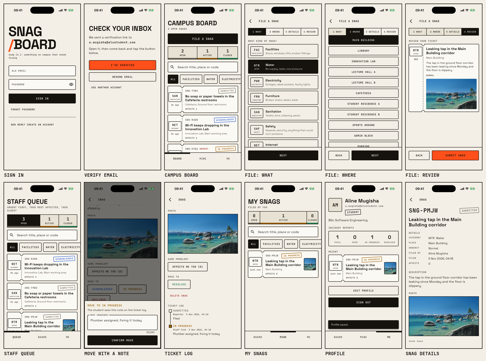

# Snagboard


Campus incident reporting for ALU. A snag is anything on campus that needs fixing: a dry tap, a dead socket, a broken chair, a safety hazard. Students file a snag with an optional photo and follow it on a shared campus board. Staff move each snag along a fixed status track and leave a note at every step, so the student always knows what is happening.

Built with Flutter, Riverpod, Firebase Authentication, Cloud Firestore and Firebase Storage. Runs on the iOS simulator (tested on iPhone 17 Pro, iOS 26.5).

Demo video: VIDEO_URL



## Try it

- Students: sign up in the app with your own ALU email (`name@alustudent.com`). Firebase sends a verification link to that inbox; tap it, return to the app and tap I've verified.
- Staff: anyone with an `@alueducation.com` address can sign up the same way, and becomes staff once a campus admin sets their role.
- Staff test account, already verified and set to staff: `s.stafftest@alueducation.com`, password `staff1234`. Sign in with it to see the staff queue and move a snag along its status track.

## Features

- Sign up, sign in, sign out and password reset. Only `@alustudent.com` and `@alueducation.com` addresses can join, and the email must be verified before the app opens.
- File a snag in four steps (What, Where, Details, Review): category, urgency, location, title, description, optional photo, and an option to hide your name from other students.
- Before filing, open snags with the same category and place are shown, with "Affects me too" instead of a duplicate report.
- Campus board with search, category filters and a status ribbon (open, in progress, closed).
- Details screen with the photo and a ticket log of every status change, who made it and their note.
- Staff queue sorted for triage (urgent first, then most affected, then oldest). Staff move a snag through Submitted, Acknowledged, In progress, Resolved or Declined, and must write a note each time.
- Owners can edit or withdraw a snag while it is still submitted. Staff can remove spam.
- Profile with photo, degree or department, an incident report summary and recent snags.

## Roles and access control

Every account starts as a student. A campus admin appoints staff by setting `role` to `staff` on the user's document in the Firestore console; the app cannot grant it. Firestore and Storage security rules enforce every permission on the server: only staff can change a status, students can only edit their own submitted snags, nobody can rewrite the history, and unverified or non-ALU accounts cannot read anything.

## Project structure

```
lib/
  auth/        sign-in state, auth controller, Firebase Auth repository
  profile/     user profiles in Firestore
  incidents/   snag model, status flow, filters, form controller, Firestore and Storage repositories
  core/        theme, validators, campus locations and programmes
  ui/          screens and reusable widgets
firestore.rules, storage.rules   server-side access control
test/          unit and widget tests
rules_test/    security rules tests (Firestore and Storage emulators)
integration_test/  end-to-end test on the simulator against the emulators
```

## Run it

Requirements: Flutter 3.47, Xcode with an iOS simulator, Node 20+, the Firebase CLI, and Java for the emulators.

```
flutter pub get
flutter run -d "iPhone 17 Pro"
```

The app connects to the Firebase project configured in `lib/firebase_options.dart`. To use your own project, run `flutterfire configure`, enable Email/Password sign-in and Storage, then deploy the rules with `firebase deploy --only firestore:rules,storage`.

## Tests

```
tool/check.sh   # analyzer, unit and widget tests, security rules tests
tool/e2e.sh     # full journey on the simulator against the local emulators
```

`tool/check.sh` fails if any test fails, any test is skipped, or no tests run.

## Report

The technical report is in `report/`.
