## 1. Introduction

Campus problems such as a dry tap, a dead socket or a broken chair are reported through group chats and hallway conversations. Students cannot tell whether anyone heard, and staff get the same complaint several times with no shared view of what is open.

Snagboard gives each problem (a "snag") one record with one visible history. Students file a snag with an optional photo and follow it on a campus board. Staff move it along a fixed status track and must leave a note at every step.

## 2. Application Architecture

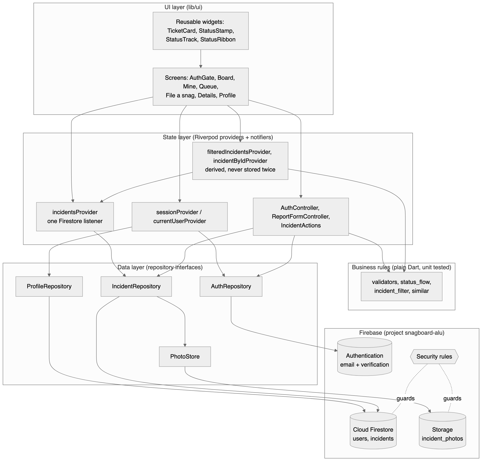

- UI (`lib/ui`): screens and reusable widgets. No screen calls Firebase.
- State: Riverpod providers and controllers (Section 4).
- Business rules: plain Dart functions for validation, status transitions, filtering and duplicate detection.
- Data: `AuthRepository`, `ProfileRepository`, `IncidentRepository` and `PhotoStore` interfaces, with Firebase implementations in the app and in-memory fakes in tests.

Navigation follows the authentication state (Figure 2). An `AuthGate` widget shows sign-in when signed out, a verify-email screen until the address is verified, and then the student or staff home.

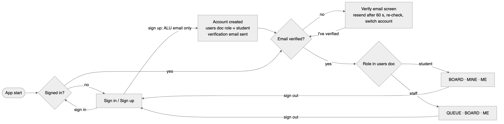

## 3. Firebase Data Structure

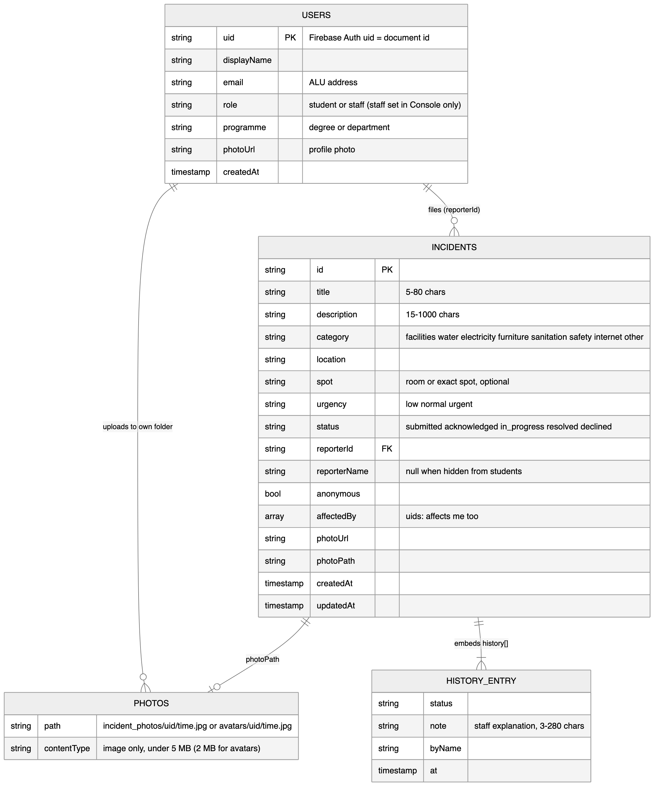

| Location | One per | Main fields |
|---|---|---|
| `users/{uid}` | account | displayName, email, role (`student` or `staff`), programme (degree or department), photoUrl, createdAt |
| `incidents/{id}` | snag | title, description, category, location, spot, urgency, status, reporterId, reporterName, anonymous, affectedBy, history, photoUrl, photoPath, createdAt, updatedAt |
| Storage `incident_photos/{uid}/{time}.jpg` | snag photo | JPEG under 5 MB, resized to 1600 px |
| Storage `avatars/{uid}/{time}.jpg` | profile photo | image under 2 MB |

Firestore organises documents into collections [2]. Each status change appends an entry (status, note, staff name, time) to the snag's `history` list. "Affects me too" is the `affectedBy` list of user ids. The app reads incidents with a single query: the 200 newest, ordered by creation time.

## 4. State Management Approach

The app uses Riverpod [5].

- Each Firebase stream is a `StreamProvider`, so every screen receives loading, error or data from one `AsyncValue` and shows a spinner or a retry panel the same way.
- One `incidentsProvider` holds the live incidents listener. The board, "Mine", the staff queue and the details screen are derived from it, so a status change appears on every screen at once.
- Controllers run actions and expose their progress: `AuthController` (sign in, sign up, reset, verification), `ReportFormController` (the four-step draft, per-step validation, upload progress) and `IncidentActions` (status changes, "affects me too", deletes).
- `setState` is used only for local widget details such as the 60-second resend countdown.

## 5. User Roles and Access Control

A verified `@alueducation.com` account becomes staff at sign-up and an `@alustudent.com` account becomes a student; the rules check the domain, so a student cannot claim staff. The project owner can still change any role in the Firebase Console. Firestore and Storage security rules [3] enforce access on the server. Every rule requires a verified email [1] ending in `@alustudent.com` or `@alueducation.com`.

| Action | Student | Staff |
|---|---|---|
| Read the board | Yes | Yes |
| File a snag | Yes | Yes |
| Edit or withdraw | Own, while submitted | No |
| Change status | No | Allowed transitions only, with a note |
| "Affects me too" | Own id only | Own id only |
| Remove a snag | Own, while submitted | Any |
| Read another user's profile | No | Yes |
| Edit own name, degree or department, photo | Yes | Yes |
| Change a role | No | No |
| Upload a photo | Own folder, image under 5 MB | Same |

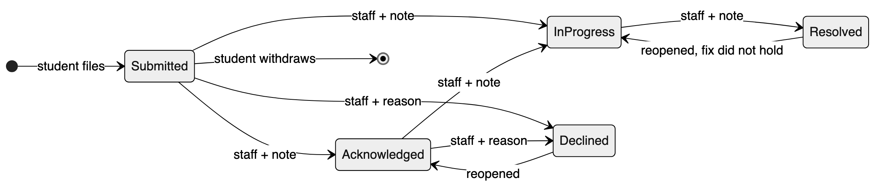

Privacy and misuse:

- A student can hide their name from other students; staff still see it.
- Before filing, the app lists open snags with the same category and location and offers "Affects me too" instead of a duplicate.
- Choosing Safety shows that the app is not monitored around the clock and points to campus security.
- Students cannot read each other's profiles or emails.

## 6. UI/UX Decisions

<figure>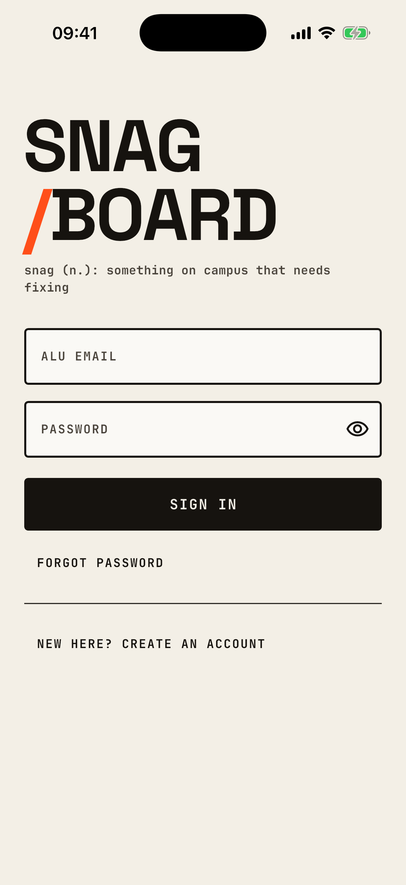<figcaption>Sign in</figcaption></figure><figure>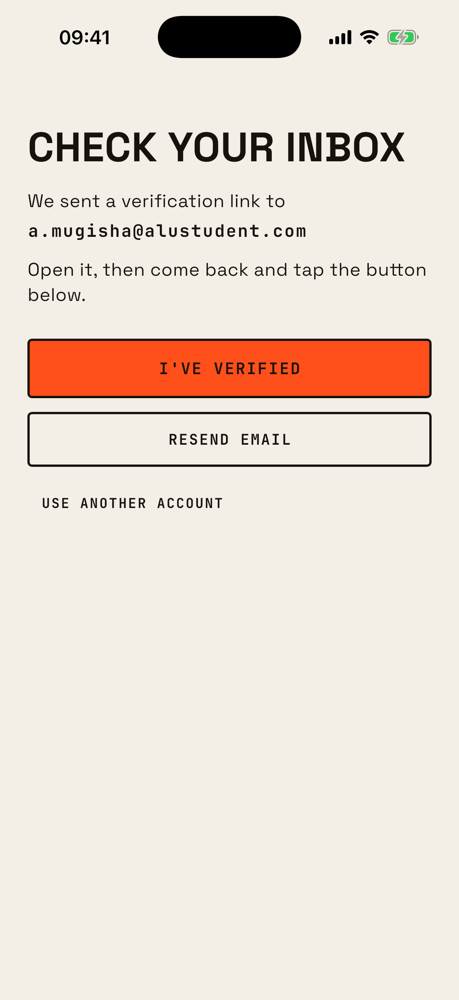<figcaption>Verify email</figcaption></figure><figure>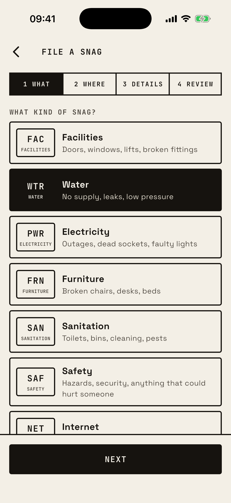<figcaption>Filing, step 1</figcaption></figure><figure>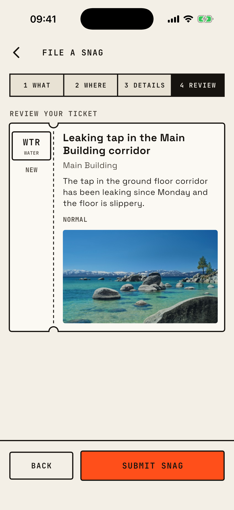<figcaption>Review with photo</figcaption></figure>

<figure>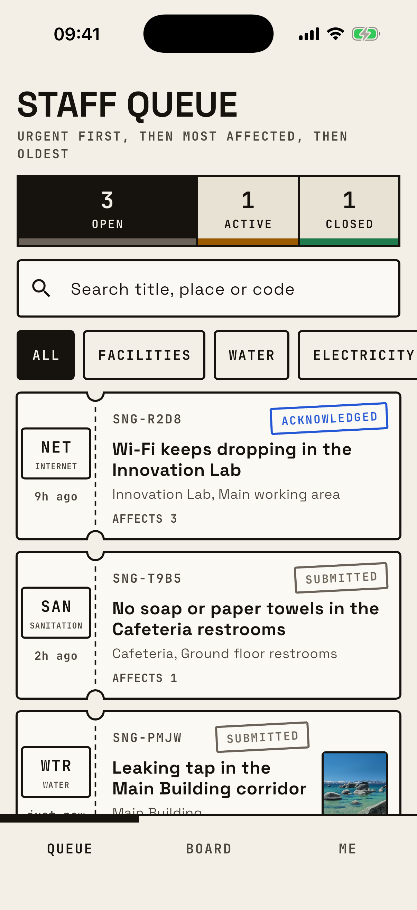<figcaption>Staff queue</figcaption></figure><figure>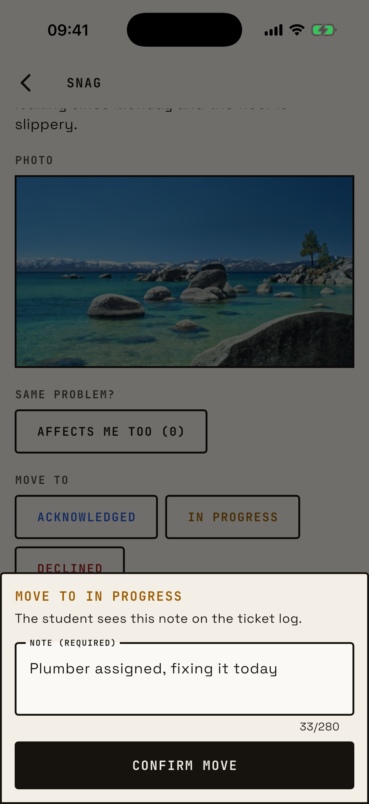<figcaption>Status change with note</figcaption></figure><figure>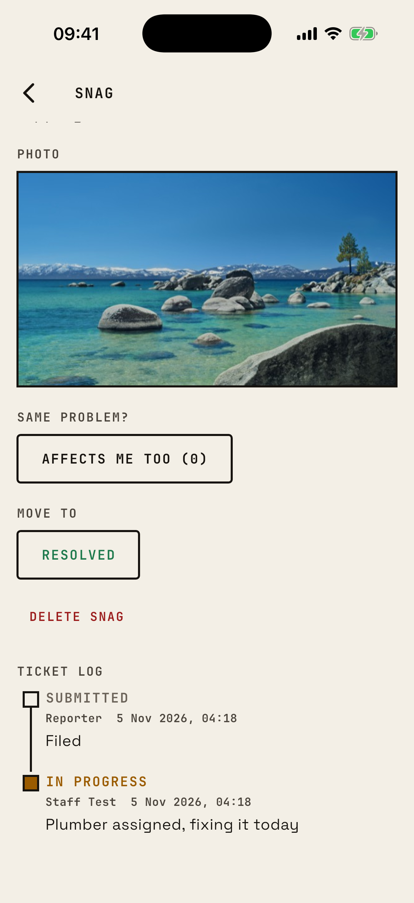<figcaption>Ticket log</figcaption></figure><figure>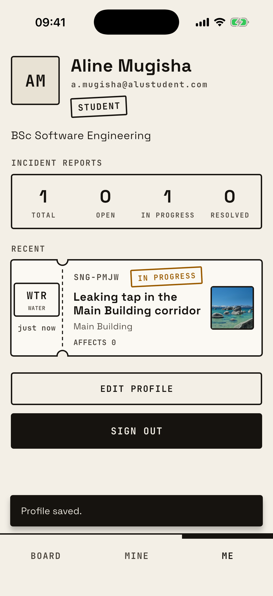<figcaption>Profile</figcaption></figure>

*Figure 5. Main workflows on the iPhone 17 Pro simulator: authentication, filing a snag, staff triage, status tracking and the profile.*

The look is a work-order board: paper background, black ink, one orange accent, 2 px outlines, and monospaced ticket codes with stamped statuses. All text colours meet the 4.5:1 contrast ratio [8].

| Decision | Reason |
|---|---|
| Filing in four steps (What, Where, Details, Review) | One question per screen, errors shown beside the field [7] |
| Categories as rows with examples | Students choose by meaning, not by icon |
| Status ribbon split into open, active and closed | Campus overview at a glance; each segment filters |
| Vertical status track with names and notes | The latest note answers "what is happening?" |
| Profile with photo, degree, report summary and recent snags | Students see their own record at a glance |
| Loading, empty and error states on every screen, errors offer Retry and Sign out | The user always knows what the app is doing and is never stuck |

## 7. Testing Strategy

Acceptance tests were written from the specification and confirmed failing before any implementation existed [6].

| Level | Covers | Tests |
|---|---|---|
| Unit | Validators, status transitions, filtering, duplicate check, model mapping, controllers | 18 |
| Widget | Auth gate per role, sign-up validation, verification, filing flow, board filters, role-based controls, cross-screen update, profile | 23 |
| Security rules | Each access-matrix row, one allowed and one refused case, on the Firestore and Storage emulators [9] | 27 |
| End to end | Student signs up and files with a photo, staff moves it to in progress, student sees the note; iPhone 17 Pro simulator on the emulators | 1 |

A gate script fails if any test fails, any is skipped, or none ran. The final run passed 41 of 41 app tests, 27 of 27 rules tests and the end-to-end test.

## 8. Challenges Encountered

- Firebase Storage now requires the pay-as-you-go Blaze plan [4]. The project was upgraded and the bucket placed in a no-cost region.
- An automated test cannot open an inbox, so the end-to-end test verifies accounts through the Auth emulator; the live demo uses a real ALU inbox.
- The usual Firebase mocking packages did not resolve against the current SDK, so repositories sit behind interfaces with hand-written fakes.
- Riverpod 3 retries failed providers automatically; tests switch this off so error states can be checked.

- The end-to-end test found a bug every other test missed: sign-up writes the profile before the email is verified, and the rules refused it. Profile creation is now the one write allowed before verification.
- After verifying, Firebase keeps the old login token, which still says "not verified", so the rules kept refusing the user. The app now refreshes the token before moving on.

## 9. Lessons Learned

- Security belongs in the rules, and the rules need their own tests, including the refused cases.
- Deriving every screen from one stream removes "updated here but not there" bugs.
- Writing tests first turned each vague requirement into a pass or fail condition.

## 10. Limitations and Future Work

- Search runs on the phone over the 200 newest snags; a larger campus needs server-side search.
- No server-side rate limit on filing; App Check and a Cloud Function quota would add one.
- No push notifications; Firebase Cloud Messaging on status change is the next step.
- A hidden-name snag still carries the reporter's user id, so two snags by the same student can be linked.
- Photos of removed snags stay in Storage until a cleanup job exists.
- Tested on iOS only.

## 11. Major Technical Decisions

| Decision | Alternative | Why |
|---|---|---|
| Riverpod | Provider, BLoC | Streams map directly to providers; derived providers keep screens in sync without a BuildContext; tests override one provider per repository |
| Repository interfaces | Firebase calls in widgets | Testable with fakes; Firebase code lives in four files |
| History embedded in the snag | `updates` subcollection | One read for details; a status change and its note are one atomic write the rules can check |
| One query, filters on the phone | A query per filter | No composite indexes, one listener, fine at campus scale |
| Rules enforce status transitions | Trust the app | A modified app cannot skip steps or rewrite history |
| Role from the verified email domain, editable in the Console | Admin-only appointment | Graders and staff are staff on sign-up with no manual step; the owner can still correct a role |

## References

[1] Google, "Manage users in Firebase (send a user a verification email)," Firebase Documentation. [Online]. Available: https://firebase.google.com/docs/auth/flutter/manage-users. Accessed: Nov. 5, 2026.

[2] Google, "Cloud Firestore data model," Firebase Documentation. [Online]. Available: https://firebase.google.com/docs/firestore/data-model. Accessed: Nov. 5, 2026.

[3] Google, "Get started with Cloud Firestore Security Rules," Firebase Documentation. [Online]. Available: https://firebase.google.com/docs/firestore/security/get-started. Accessed: Nov. 5, 2026.

[4] Google, "FAQs about changes to Cloud Storage for Firebase pricing and default buckets," Firebase Documentation. [Online]. Available: https://firebase.google.com/docs/storage/faqs-storage-changes-announced-sept-2024. Accessed: Nov. 5, 2026.

[5] R. Rousselet, "Getting started," Riverpod Documentation. [Online]. Available: https://riverpod.dev/docs/introduction/getting_started. Accessed: Nov. 5, 2026.

[6] Google, "Testing Flutter apps," Flutter Documentation. [Online]. Available: https://docs.flutter.dev/testing/overview. Accessed: Nov. 5, 2026.

[7] J. Nielsen, "10 usability heuristics for user interface design," Nielsen Norman Group, 1994, updated Jan. 30, 2024. [Online]. Available: https://www.nngroup.com/articles/ten-usability-heuristics/. Accessed: Nov. 5, 2026.

[8] W3C, "Web Content Accessibility Guidelines (WCAG) 2.1," W3C Recommendation, Jun. 5, 2018. [Online]. Available: https://www.w3.org/TR/WCAG21/. Accessed: Nov. 5, 2026.

[9] Google, "Test your Cloud Firestore Security Rules," Firebase Documentation. [Online]. Available: https://firebase.google.com/docs/rules/unit-tests. Accessed: Nov. 5, 2026.
